<a href="https://0xui.io"></a>

<p align="center">
  <a href="https://0xui.io/getting-started/installation/">Docs</a> ·
  <a href="https://0xui.io/components/">Components</a> ·
  <a href="https://0xui.io/blocks/">Blocks</a> ·
  <a href="https://0xui.io/getting-started/hello-dapp/">Hello dapp</a> ·
  <a href="https://0xui.io/llms.txt">llms.txt</a>
</p>

# 0xui

Web3 React components you copy into your app. Built on [wagmi](https://wagmi.sh), [viem](https://viem.sh), [Base UI](https://base-ui.com) and Tailwind CSS v4, and installed with the [shadcn CLI](https://ui.shadcn.com/docs/cli).

Every component handles the states real wallets produce: pending, cancelled in wallet, wrong network, error. Each one exports its hook, so you can keep the logic and bring your own UI.

<table>
  <tr>
    <td width="50%" valign="top">
      <sub><code>01</code></sub><br>
      <b>You own the code</b><br>
      Components are copied into your project as source. There is no package to upgrade around and nothing to override.
    </td>
    <td width="50%" valign="top">
      <sub><code>02</code></sub><br>
      <b>Every state handled</b><br>
      Pending, cancelled in wallet, wrong network, error. Each one is designed, named, and exported as a type.
    </td>
  </tr>
  <tr>
    <td width="50%" valign="top">
      <sub><code>03</code></sub><br>
      <b>Headless when you need it</b><br>
      Every component exports its hook. Keep the logic and bring your own UI.
    </td>
    <td width="50%" valign="top">
      <sub><code>04</code></sub><br>
      <b>Ready for agents</b><br>
      Rich registry descriptions, JSDoc on every prop, and installable through the shadcn MCP server.
    </td>
  </tr>
</table>

## Install

0xui is a [shadcn registry](https://ui.shadcn.com/docs/registry). It needs Tailwind CSS v4 and the [Base UI](https://base-ui.com) flavor of shadcn (`npx shadcn@latest init --base base`).

Add the registry to `components.json`:

```json
{
  "registries": {
    "@0xui": "https://0xui.io/r/{name}.json"
  }
}
```

Set up wagmi (skip this if you already have a `WagmiProvider`), then add components:

```bash
npx shadcn@latest add @0xui/wagmi-config
npx shadcn@latest add @0xui/wallet-button
```

The [installation guide](https://0xui.io/getting-started/installation/) has the details. [Hello dapp](https://0xui.io/getting-started/hello-dapp/) is a whole dapp in about 40 lines.

## Components

### Blocks

Whole features assembled from the components. Install one and change what you need.

| | |
| --- | --- |
| [`swap`](https://0xui.io/blocks/swap/) | Swap block with bring-your-own quotes, approval step, rate and price impact. |
| [`send`](https://0xui.io/blocks/send/) | Send block for ETH and ERC-20s with ENS recipients. |
| [`portfolio`](https://0xui.io/blocks/portfolio/) | Token holdings with total value. |

### Wallet

Connect, show the account, sign.

| | |
| --- | --- |
| [`wallet-button`](https://0xui.io/components/wallet-button/) | Connect button when disconnected, account when connected. Start here. |
| [`connect-wallet`](https://0xui.io/components/connect-wallet/) | Wallet picker with recent/installed wallets and cancel handling. |
| [`account`](https://0xui.io/components/account/) | Connected-account button and panel: balance, copy, explorer, disconnect. |
| [`sign-message`](https://0xui.io/components/sign-message/) | Sign messages or typed data, with optional verification. |

### Network

Pick a chain, guard against the wrong one, show its pulse.

| | |
| --- | --- |
| [`chain-selector`](https://0xui.io/components/chain-selector/) | Network switcher as a popover or dialog. |
| [`network-guard`](https://0xui.io/components/network-guard/) | "Switch to X" notice for chain-specific content. |
| [`chain-badge`](https://0xui.io/components/chain-badge/) | Static chain chip. Also exports `ChainIcon`. |
| [`block-number`](https://0xui.io/components/block-number/) | Live block number and RPC health. |
| [`gas-price`](https://0xui.io/components/gas-price/) | Current gas in gwei, with optional low/medium/high tone. |

### Identity

Addresses, ENS names and avatars.

| | |
| --- | --- |
| [`address`](https://0xui.io/components/address/) | ENS name or truncated address, with copy and explorer link. |
| [`address-input`](https://0xui.io/components/address-input/) | Address or ENS input with resolution and checksum validation. Optionally accepts private `0zk` addresses. |
| [`address-avatar`](https://0xui.io/components/address-avatar/) | ENS avatar or a gradient derived from the address. |
| [`ens-profile`](https://0xui.io/components/ens-profile/) | ENS profile card: avatar, bio, links. |
| [`explorer-link`](https://0xui.io/components/explorer-link/) | Link to an address, tx or block on the chain's explorer. |

### Tokens

Balances, amounts and token pickers.

| | |
| --- | --- |
| [`token-input`](https://0xui.io/components/token-input/) | Swap panel: amount, token picker, fiat, balance with Max, insufficient state. |
| [`token-select`](https://0xui.io/components/token-select/) | Searchable token picker with recent/popular tokens and balances. |
| [`amount-input`](https://0xui.io/components/amount-input/) | Decimal amount input with string state and decimal clamping. |
| [`balance`](https://0xui.io/components/balance/) | Native or ERC-20 balance. |
| [`token-amount`](https://0xui.io/components/token-amount/) | `bigint` amount formatting, with optional fiat value. |
| [`token-icon`](https://0xui.io/components/token-icon/) | Token logo with fallbacks and an optional chain badge. |
| [`add-token`](https://0xui.io/components/add-token/) | "Add USDC to wallet". |
| [`nft-card`](https://0xui.io/components/nft-card/) | ERC-721/1155 card from on-chain metadata. |

### Transactions

Send, approve, track and read contracts.

| | |
| --- | --- |
| [`transaction-button`](https://0xui.io/components/transaction-button/) | Sends a transaction and shows every step: connect, switch, confirm, pending, done. |
| [`approve-button`](https://0xui.io/components/approve-button/) | ERC-20 approval gate in front of your action. |
| [`batch-transaction`](https://0xui.io/components/batch-transaction/) | Several calls in one wallet prompt (EIP-5792), step by step otherwise. |
| [`transaction-status`](https://0xui.io/components/transaction-status/) | Inline card that follows a transaction from submitted to confirmed. |
| [`transaction-toast`](https://0xui.io/components/transaction-toast/) | Follow a transaction in a Sonner toast. |
| [`transaction-history`](https://0xui.io/components/transaction-history/) | Transactions sent from your app with live status. |
| [`contract-form`](https://0xui.io/components/contract-form/) | Read/write forms for any contract from its ABI. |
| [`event-feed`](https://0xui.io/components/event-feed/) | Live feed of a contract's events. |

### Utilities

Small pieces the other components are built from, and tools for browser agents.

| | |
| --- | --- |
| [`copy-button`](https://0xui.io/components/copy-button/) | Copy to clipboard with confirmation. |
| [`responsive-dialog`](https://0xui.io/components/responsive-dialog/) | A dialog that becomes a bottom drawer on small screens. |
| [`morph-text`](https://0xui.io/components/morph-text/) | Text that morphs from the old value to the new one when it changes. |
| [`agent-tools`](https://0xui.io/components/agent-tools/) | WebMCP tools that let browser agents read the wallet, its balances and chains. |

Shared helpers install on their own as dependencies: `0xui-utils` (address and amount formatting, explorer links), `use-mounted`, `use-copy`.

### Shielded (preview)

Components for private balances. They talk to a shielded engine, and only a mock engine exists so far. Not for real funds: `shielded-account` has not had a security review. The docs site leaves these out of its sidebar, search, `llms.txt` and agent skill until a real engine works; [/shielded/](https://0xui.io/shielded/) links them all.

<details>
<summary>The 10 shielded items</summary>

| Item | Description |
| --- | --- |
| `shielded-engine` | The interface between the components and a privacy protocol, with its provider and hooks. |
| `mock-shielded-engine` | In-memory engine for demos and tests. No network, no funds. |
| `shield` | Shield block: fee, wait and wallet prompts up front, then sign, approve and shield one click at a time (approve and shield in one prompt on batching wallets), and the funds followed until spendable. Two variants. |
| `shielded-account` | Create, import, unlock and lock the private account, with a recovery phrase step. |
| `shielded-transaction-status` | Follows a shield from the public chain into the private balance. |
| `shielded-balance` | Private balance of a token, split into spendable, pending, proving, incomplete and restricted. |
| `shielded-sync-status` | Scan progress with a bar that never moves backwards, and a retry. |
| `proof-progress` | Proof generation as stages, with cancel and retry. |
| `shielded-address` | Truncated private address with copy. |
| `privacy-badge` | Marks a value or action as public or private. |

</details>

See [PLAN.md](./PLAN.md) for the roadmap.

## For agents

0xui is built to be read by agents as well as people.

```bash
npx skills add https://0xui.io                         # the agent skill
npx shadcn@latest mcp init --client claude    # browse and install through the shadcn MCP server
```

| URL | What it returns |
| --- | --- |
| [`/llms.txt`](https://0xui.io/llms.txt) | Setup and a one-line description of every page. Start here. |
| [`/llms-full.txt`](https://0xui.io/llms-full.txt) | Every page in one file. |
| Any page URL + `.md` | One page as Markdown. |
| `/r/<name>.json` | The registry item: dependencies and the full source of every file. |
| `/props/<name>.json` | The component's props, generated from its TypeScript types. |

More in the [AI agents guide](https://0xui.io/getting-started/agents/).

## Development

```bash
bun install
bun run dev     # docs site with live demos
bun run test    # Vitest, using wagmi's mock connector
bun run check   # typecheck
bun run lint
```

<details>
<summary>Where things live</summary>

| Path | What lives there |
| --- | --- |
| `registry/default/` | The product. Laid out the way files land in a user's app (`components/`, `hooks/`, `lib/`). |
| `registry.json` | Registry manifest. `bun run registry:build` writes `public/r/*.json`. |
| `src/content/docs/` | Docs pages (Astro Starlight). |
| `src/demos/` | Live demos. Each export is one Astro island wrapped in a demo wallet. |
| `skills/0xui/SKILL.md` | Agent skill, served at `/.well-known/agent-skills/`. List new components in its table (a test checks). |
| `src/lib/agent-docs.ts` | Markdown for agents: `/<page>.md`, `/llms.txt`, `/llms-full.txt`. `src/lib/webmcp.ts` registers the WebMCP tools. |
| `registry/default/examples/` | A `<name>-demo` example per component, found by the shadcn MCP server. |
| `src/lib/props.ts` | Props from the TypeScript types: `/props/<name>.json`, and a test that fails when a docs Props table lists a prop the code doesn't have. |
| `worker/`, `wrangler.jsonc` | Cloudflare Worker in front of the static site: answers `Accept: text/markdown` and adds `Link` headers. Deploy with `bun run deploy`. |
| `scripts/agent-eval/` | Agent evals: Claude Code builds tasks in a fresh app with the skill, then a checker grades it. `bun run eval:agents`. |
| `scripts/smoke-install.sh` | Installs every item into a fresh shadcn app and builds it. Runs in CI. |

</details>

In this repo, `@/…` imports resolve to `registry/default/` first and then `src/`, so registry code uses the same import paths it will have after install.

---

Built by [Fimbul Labs](https://fimbul.io).
